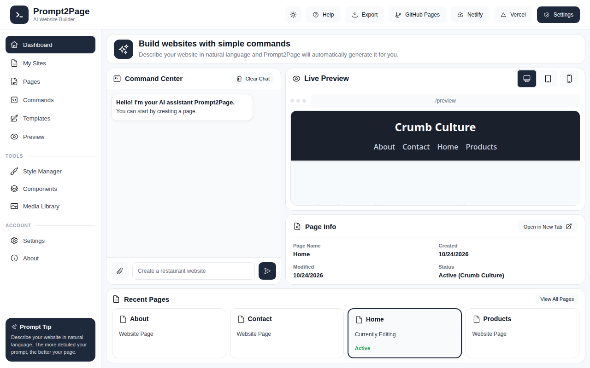

# Prompt2Page

A website builder you talk to. Describe the site you want in plain words, and Prompt2Page builds it — then keep chatting to change colors, rewrite headlines, add pages and sections, and export the finished site.



## Features

- Build complete multi-page websites from a single sentence
- 15 business types — restaurants, bakeries, cafes, portfolios, stores, gyms, salons, and more
- Edit by chatting: colors, backgrounds, headlines, buttons, sections
- Add, rename, switch, and delete pages and whole sites
- Undo and redo for every change
- Live preview with desktop, tablet, and mobile views
- Export as a ZIP, or publish straight to Netlify, Vercel, or GitHub Pages
- Every build looks a little different — colors, fonts, and layout details vary per project

## Getting started

```sh
npm install
node server.js
```

Then open http://localhost:3000 in your browser.

## Example commands

```
Create a portfolio website for Muhammad Taha
I need a bakery website
Switch to the home page
Change the headline to Fresh Bread Daily
Make the background dark
Change the primary color to purple
Add testimonials
Add a services page
Undo
```

## Tech stack

Node.js and Express on the backend, vanilla JavaScript, HTML, and CSS on the frontend. No build step, no database — projects are stored as plain files, so a site you build can be downloaded and hosted anywhere.

## Authors

Built by Muhammad Taha and Afnan Siddiqui.
